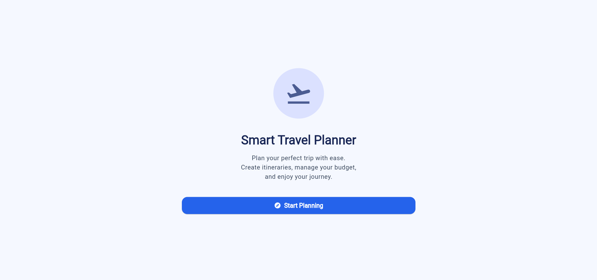
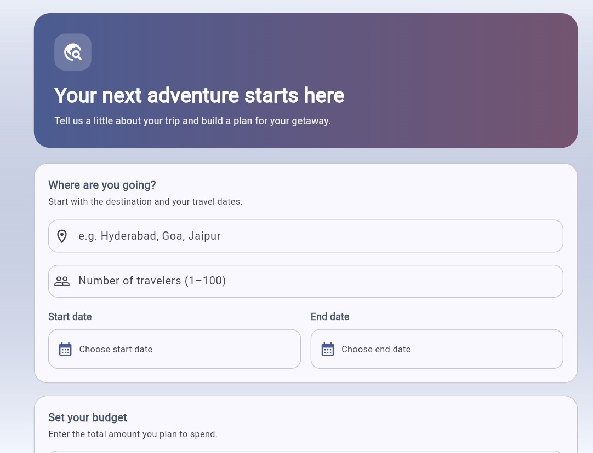
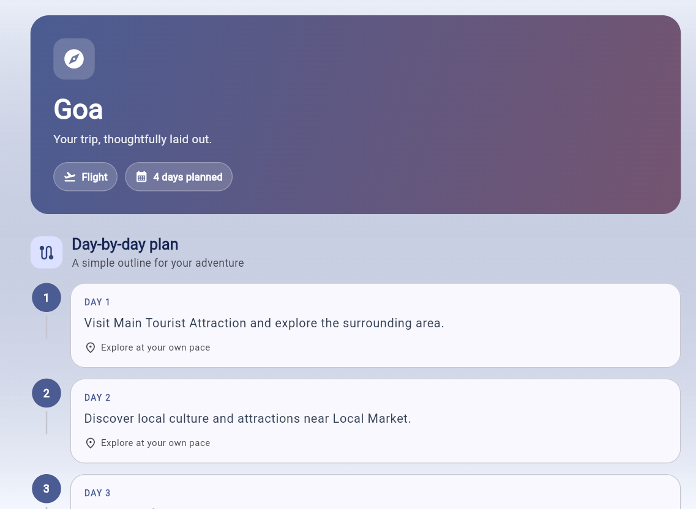
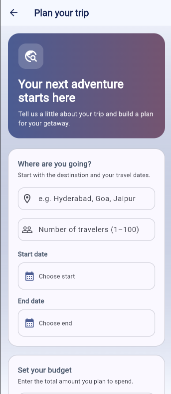

# Smart Travel Planner ✈️

A Flutter-based Smart Travel Planner application developed as part of the **UI Design Lab**. The app helps users plan trips by entering destinations, travel dates, budgets, travel modes, and personal preferences, then view a day-wise travel itinerary.

**Live Demo:** [Smart Travel Planner](https://vijayahasini2007.github.io/smart_travel_planner/)

**GitHub Repository:** [smart_travel_planner](https://github.com/vijayahasini2007/smart_travel_planner)

## 🚀 Features

- **Trip Planning:** Enter a destination, travel dates, number of travelers, and budget.
- **Travel Preferences:** Select preferred travel modes and interests for trip planning.
- **Itinerary Generation:** Generate a day-wise itinerary based on the selected destination and trip duration.
- **Form Validation:** Validate destination details, travel dates, budget, and traveler count before generating a trip.
- **Responsive UI:** Adapts the trip-details form and itinerary screens to mobile, tablet, and desktop layouts.
- **State Management:** Uses the Provider package to manage trip details and itinerary data across screens.
- **Navigation:** Navigate between the trip-planning and itinerary screens.
- **Reusable UI Components:** Uses custom widgets for itinerary cards, information pills, and other interface elements.
- **Themes and Styling:** Uses Material Design components, consistent styling, and a coordinated color theme.
- **Animations:** Includes Flutter animation widgets to enhance the user interface.
- **HTTP Dependency:** Includes the `http` package for HTTP communication.
- **Automated Testing:** Includes widget tests and unit tests for Provider state management.
- **Continuous Deployment:** Uses GitHub Actions to build and deploy the Flutter web application to GitHub Pages.

## 🛠️ Technologies Used

- **Framework:** Flutter
- **Programming Language:** Dart
- **State Management:** Provider
- **Networking:** HTTP package
- **UI Design:** Material Design
- **Testing:** Flutter Test
- **Static Analysis:** Flutter Analyzer
- **Version Control:** Git and GitHub
- **CI/CD:** GitHub Actions
- **Deployment:** GitHub Pages

## 📋 UI Design Lab Experiments

The project covers the following 10 experiments.

| **No.** | **Experiment** | **Implementation** |
|---:|---|---|
| 1 | Introduction to Flutter and Dart Basics | Flutter application setup, Dart classes, and application structure |
| 2 | Flutter Widgets and Layouts | Forms, cards, buttons, rows, columns, and Material widgets |
| 3 | Responsive UI Design | Responsive layouts for mobile, tablet, and desktop screen sizes |
| 4 | Navigation | Navigation between trip-planning and itinerary screens |
| 5 | State Management | Provider for sharing and updating trip details and itinerary data |
| 6 | Custom Widgets, Themes, and Styling | Reusable UI components and consistent Material styling |
| 7 | Forms, Validation, and Error Handling | Destination, date, budget, and traveler input validation |
| 8 | Animations in Flutter | Animation widgets used in the interface |
| 9 | REST API Integration | HTTP-based communication and response handling, where implemented |
| 10 | Testing and Debugging | Provider unit tests, widget tests, and Flutter static analysis |

## ⚙️ Getting Started

### Prerequisites

Install the following tools:

- Flutter SDK
- Dart SDK (included with Flutter)
- Visual Studio Code or Android Studio
- Google Chrome for running the web version

### Installation

1. Clone the repository:

   ```bash
   git clone https://github.com/vijayahasini2007/smart_travel_planner.git
   ```

2. Navigate to the project directory:

   ```bash
   cd smart_travel_planner
   ```

3. Install dependencies:

   ```bash
   flutter pub get
   ```

4. Run the application in Chrome:

   ```bash
   flutter run -d chrome
   ```

## 🧪 Testing and Debugging

Run the static analyzer:

```bash
flutter analyze
```

Run all automated tests:

```bash
flutter test
```

Run the Provider unit tests:

```bash
flutter test test/trip_provider_test.dart
```

Run the widget tests:

```bash
flutter test test/widget_test.dart
```

The test suite includes checks for selected Provider operations and application behavior. The exact coverage depends on the test cases implemented in the project.

## 📸 Screenshots

Add screenshots captured from the actual running application to the `screenshots/` directory.

### Home Screen



### Trip Details Form



### Generated Itinerary



### Responsive Interface



> **Note:** These screenshot references require the corresponding image files to exist in the `screenshots/` directory. Replace the filenames if your actual screenshots use different names.

## 📂 Project Structure

```text
smart_travel_planner/
├── .github/
│   └── workflows/
│       └── deploy.yml
├── lib/
│   ├── models/
│   ├── providers/
│   ├── screens/
│   ├── services/
│   └── main.dart
├── test/
│   ├── widget_test.dart
│   └── trip_provider_test.dart
├── screenshots/
│   ├── home.png
│   ├── trip_details.png
│   ├── itinerary.png
│   └── responsive_ui.png
├── pubspec.yaml
├── pubspec.lock
└── README.md
```

## 🎯 Learning Outcomes

Through this project, the following concepts are practiced:

- Building user interfaces with Flutter and Dart
- Creating layouts using Flutter widgets
- Designing responsive interfaces for different screen sizes
- Navigating between application screens
- Managing shared application state using Provider
- Creating reusable widgets and applying themes
- Validating form inputs and handling invalid data
- Using Flutter animations
- Working with HTTP dependencies and API-related functionality
- Writing unit and widget tests
- Debugging and analyzing Flutter applications
- Managing source code using Git and GitHub
- Automating web builds and deployment with GitHub Actions

## 👨‍💻 Project Information

**Project:** Smart Travel Planner

**Course:** UI Design Lab

**Framework:** Flutter

**Language:** Dart

## 📄 License

This project was developed for educational and academic purposes. No separate open-source license has been specified.

---

**Built with Flutter and Dart as part of the UI Design Lab.**